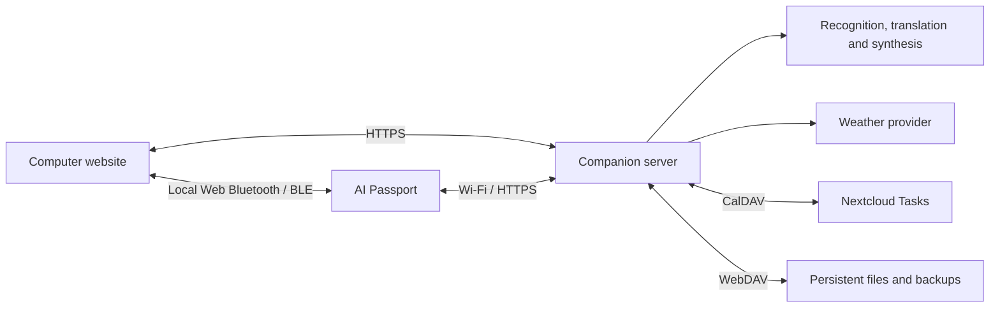

[简体中文](passport-suite-plan.zh_CN.md) · **English**

# AI Passport Integrated Firmware Plan

Updated: 2026-10-26, Asia/Shanghai. Status: home, weather, settings and browser BLE provisioning are implemented; the accepted Tasks subset includes reading, completion, offline cache/normal-reboot replay and MiMo voice creation. Translation T1 (MiMo speech recognition plus text translation) is implemented and deployed, and one authorized synthetic real-provider smoke passed. On 2026-10-25 the original OC-11 application was restored app-only after a mistaken flash; the operator confirmed the restored menu and original data are normal, while an earlier original-image trial had failed at `FAIL_CACHE_ALLOCATION` (`failure_result=6`) before readiness or microphone, with unknown memory cause. The current installed application is package `d2975d36...`, app `79a0d3b5...`, ELF `9d71323f...`, 3,697,184 bytes, installed 2026-10-26 by one guarded app-only write at `[0x10000,0x397000)`; guard rc0 PASS, the fresh 4,096-byte table sector matched `ba728028...` before the app write, the pinned esptool digest matched with one success marker, and COM3 was released. A 100.95 s bounded no-reset startup window received 0 serial bytes, 0 TRDIAG events and 0 fault markers, with no boot ELF line or trace; absent data is not a stable or startup PASS. After the human declared readiness, two guided manual translations (one EN->zh, one zh->EN) passed the operator-reported recognition/translation/display check with no obvious stutter; the operator found response speed not very fast but acceptable, and the latency cause is undetermined. Device tests are PASS only for that one-trial-per-direction subset. The prior `902a0930...` install is superseded dated history: its operator-reported ready-plus-record-entry plus UP-cancel round was normal, and its later actual EN->zh-CN attempt failed after recording and OK stop with the translation-cache OOM message and no A/F/L; the failed HTTP call and onboard heap largest/free block are unknown. The 2026-10-26 complete-gate Build/Host PASS is reused with no firmware rerun. The earlier `cb8bd517...` TLS-preflight failure and weather `task_wdt` remain superseded dated history with unproven relationship. Exact current evidence is in the [T1 core current checkpoint](passport-translation-t1-core.md#current-checkpoint-2026-10-26). T2/TTS is unimplemented and SA-15 remains incomplete; OTP and wallet remain development placeholders, and the remaining proposals are not implemented merely because they appear below.

The target is one firmware application with five features and an online management website. A nearby browser connects to the device over Bluetooth; the device uses its own Wi-Fi for online services. The user has accepted optional phone-browser provisioning, verified with Android Edge. The original computer-browser goal remains unverified. Daily operation after setup does not require a phone application or hotspot.

The user determines scope and acceptance; the explicitly authorized coding agent implements, reviews and validates each increment. Engineering follows [AGENTS.md](../../AGENTS.md) and the [AI development guide](../development/ai-guide.md).

Confirmed on 2026-10-20: prefer Simplified Chinese for user-facing UI, including
actions, key hints, empty/loading states and errors (PRD SU-16). Preserve user
content and necessary standard identifiers. The task reader correction pins
Refresh above the list and focuses it on entry, even when cached tasks exist.

## 0 Current implementation and acceptance

Updated 2026-10-26. This section supersedes blanket implementation-status statements
in the 2026-10-05 design documents; their unmet requirements and decision gates still
apply.

The current gap is performance timing localization and the remaining unaccepted
scenarios, not missing basic translation or another flash. The
installed application is package `d2975d36...`, app `79a0d3b5...`, ELF `9d71323f...`,
3,697,184 bytes, written app-only at `[0x10000,0x397000)` on 2026-10-26 by one guarded
write. Guard rc0 PASS `APP_ONLY_WRITE_DIGEST_AND_CLOSE`, a single 78.57 s execute, one
read plus one write bridge session each closed, COM3 release confirmed, and the fresh
live 4,096-byte table sector matched `ba728028...` before the app write; the pinned
esptool digest comparison matched with one success marker. No bootloader/table/data/key
was written, and settings/keys/cache/journals are preserved by range separation only.
The full package is the application-source package identity, not a whole-Flash clone.
A 100.95 s bounded no-reset startup window received 0 serial bytes, 0 TRDIAG events and
0 fault markers, with no boot ELF line or trace; that is dated startup evidence, not a
clean, stable or startup PASS. Two guided manual trials, one per direction, were then
completed on this install: the operator reported correct recognition, translation and
display and no obvious stutter, found the response speed not very fast but acceptable, and the
latency cause is undetermined. Device tests are PASS only for that
one-trial-per-direction subset. The prior
`902a0930...` / app `a71b9c3e...` / ELF `0352858d...` install is superseded dated
history: its ready/cancel subset was operator-reported normal, and its later real
EN->zh-CN attempt failed after recording and OK stop with the translation-cache OOM
message and no A/F/L; the specific failed HTTP call and onboard heap largest/free block
are unknown. The earlier `cb8bd517...` / app `d0396c22...` / ELF `0ac23853...`
TLS-preflight failure and one weather `task_wdt` are superseded history with unproven
relationship. The 2026-10-26 complete-gate Build/Host PASS is reused with no firmware
rerun. Exact screens, captures and memory details are in the
[T1 core current checkpoint](passport-translation-t1-core.md#current-checkpoint-2026-10-26).
The superseded `43501...` trial is the source of the historical human `R7 H0 B0`;
original `f9a849be...` / `f5be0652...` and the `8e86` archive remain
historical/rollback. The `d2975d36` flash used its own current human conditional
authorization and independent Codex review; this document neither authorizes nor
infers any further flash.

| Area | Implemented behavior | Evidence and remaining boundary |
| --- | --- | --- |
| Home scene | Mutual softened gravity, finite-radius elastic contacts with swept collision detection, bounded speed/work, reflecting bounds and short trails | Host force/contact/grazing/recovery tests and deterministic 100,000-frame runs pass in default and optimized builds. Operator confirms suitable speed, rebound without solid-body penetration, legible Chinese and clock |
| Navigation | New home, launcher, settings and long-press return | Two operator-observed menu/return rounds passed; provisioning entry was intentional |
| Browser provisioning | Screen QR, NimBLE connection, six-digit application pairing code, Wi-Fi scan/save, city save | Android Edge operator checks passed through correct pairing, multiple scan results, connection/IP, city matching and weather display. One wrong code was rejected on the phone; the correct code then recovered in the same session |
| Clock and weather | Network time, selected-city weather, separate model/state handling | Operator confirms synchronized correct date/time and displayed temperature/weather; exact operation durations were not supplied |
| Security and persistence | Current BLE application-code check, NVS settings, and encrypted task/translation configuration partitions | This is not acceptance of the proposed authenticated encrypted SC-02 session, signed trusted time or OTP security. Recent boots automatically reconnected saved Wi-Fi, and segmented writes preserved the non-application data partitions; exact other setting, schema and security checks are not all established |
| Tasks | List/details, manual snapshot download, two-slot cache, explicit completion, eight-intent durable replay, separate write token and MiMo voice creation | See [device tasks](passport-device-tasks.md). Approved deployment, Wi-Fi/time/weather startup, operator completion/cache/normal-reboot replay, voice preview/default cancel/recognition and creation-intent reboot retention passed. The 2026-10-23 measured cancel/re-entry subset is closed at the operator's request; genuine concurrent-edit conflict, physical power cuts and true resource peaks remain unverified |
| Translation | Launcher page, explicit direction, MiMo capture/upload/poll worker with explicit local MOCK, encrypted configuration, translation-only USB provisioning and a separately deployed companion service | Real T1 code, focused host tests and a targeted ESP-IDF build passed; companion deployment uses MiMo `mimo-v2.5-asr` plus `mimo-v2.6-flash`, and one authorized synthetic real-provider EN->zh-CN smoke passed in 7.445 s with one ASR and one MT claim. The original OC-11 application was restored app-only on 2026-10-25 and the operator confirmed the restored menu and original data normal; an earlier original-image readiness attempt failed at `FAIL_CACHE_ALLOCATION` (`failure_result=6`) before readiness or microphone. The current `d2975d36` post-recording response-cache application was installed app-only on 2026-10-26 with guard rc0 PASS; its 100.95 s bounded no-reset startup window received 0 serial bytes, 0 TRDIAG events and 0 fault markers, with no boot ELF line or trace, which is dated startup evidence and not a stable or startup PASS. Two guided manual trials, one EN->zh and one zh->EN, then passed the operator-reported recording, recognition, text-translation and display check with no obvious stutter; the operator found speed not very fast but acceptable, and the latency cause is undetermined. Device tests are PASS only for that one-trial-per-direction subset, without repeatability, leak-free, TTS or SA-15 acceptance. The prior `902a0930` install is superseded dated history: its ready/cancel subset was operator-reported normal, and its later real EN->zh-CN attempt failed after recording and OK stop with the translation-cache OOM message and no A/F/L. The failed HTTP call and onboard heap largest/free block are unknown. The 2026-10-26 complete-gate Build/Host PASS is reused with no firmware rerun. The earlier `cb8bd517` TLS-preflight failure and weather `task_wdt` remain superseded history with unproven relation. See the [T1 core current checkpoint](passport-translation-t1-core.md#current-checkpoint-2026-10-26) for exact screens, captures and the remaining gaps. This is not repeatability, invoice or SA-15 verification |
| OTP, wallet | Explicit development placeholders in the launcher | No implementation or business-feature acceptance |

### Artifact identities, 2026-10-25

| Role | Full image SHA-256 | Application SHA-256 | ELF SHA-256 |
| --- | --- | --- | --- |
| Approved native OC-11 package; original f9/f5 application restored earlier (app-only recovery, 2026-10-25), user-confirmed menu/data normal, now superseded; archive retained as rollback | `8e86d04143d5db795b966536007bdc81918cd63564c2d3b615a0d968f6835f1e` | `f9a849bee50860667d7323bc48d2da9a7c7f8629e79f100abf725a9a2329fd18` | `f5be0652e9fe9d9f70c91b5c9f2e2eb7fd9915b077bf1a84df3ad87ccf0d0170` |
| Previous installed TLS snapshot application, 2026-10-25 — SUPERSEDED history; one EN->zh-CN TLS-preflight FAIL and one weather task_wdt, relationship to 902a unknown | `cb8bd51719e57e7f3ae1d87d6a7c55ed5145dd4d45c9349c86ee2ebacf0d9a03` | `d0396c225ff00fbe5f4319e4c757b44dd8d4071beed0c2dbfad24fa7be7170fc` | `0ac23853615f24ab2a294389e590e7a6665f8a804955a3089548536f8b194281` |
| Current installed post-recording response-cache application, 2026-10-26 — guarded app-only write PASS; startup bounded; operator-reported one-trial-per-direction bilingual device tests PASS | `d2975d36eca1b89d98dd27f47711833f06afb4a8bb9a618eee11b0d357b94b0d` | `79a0d3b5a59f5d1084267642837566b66054cb5d3ff3e06003457197371f59c1` | `9d71323ff8a1eb3231171dd2e6834f0f19d2ed07fb52c8fd413d4a97091ab66f` |
| Superseded installed TLS memory-lifetime application, 2026-10-26 — replaced by d2975d36; operator ready/cancel subset PASS, later real EN->zh-CN FAIL after recording (cache OOM) | `902a0930c258cc93920811b7291f19a60c26f9f4ba73715ddab776d846c65fff` | `a71b9c3eeaf4c4594cb646333ea11a71fe2b77efdee53e6de07fff95818158b6` | `0352858d245e8a5c181f4b1a17efe3ebdbc9baec3b356ebcd58fc78cc5a33bff` |
| Superseded diagnostic application, 2026-10-25 — prior R7 H0 B0 trial; replaced by cb8bd517 | `43501bd4e8640969abd402d178346001fad1dca308a4486bcd67755cb9d7e8ff` | `4b1fc8173c6d859c1ae01f15035b01677f43f2a5591061152a68424208ec4d19` | `8f65263c6a3f2b481b03579273aaef0c27bcbcdf1791e0a13809bd91c4be16e9` |
| Validation-only native archive, 2026-10-24 (never flashed) | `119f73c2ae8182b42c8a77de42a1a588707274885087901f13f20541a0497d03` | Not recorded in this plan | `f4f4f1543d5e6b831ba7da69ee6a46c4d287fff8a883f03f6bde86c8d2c1a662` |
| Documentation-only gate archive, 2026-10-25 — VALIDATION_ONLY_NOT_FLASHED | `c3b3795374405a97182e6ce447a1193caff286da8df7b9b82aafd98c0cd6dc63` | `f7584fd364169adc6b7d4117350e7d11d38780a6f4f5850d3725a8c3f8d1b98c` | `abce9bd8999825682267406f51253ece0b2871454a47adc2abcc27e62a5fc367` |
| Mistaken older Windows build, 2026-10-25 (dated incident; no longer installed) | `4b0187a075d403915d0fd7e09a6a4d72a104cd9a899a2a69af7bb2a74204495a` | `ecbbdc449374d99ad687350288b56c0c5df5b572b4ed255dbb2b1f05dbdb2e65` | `06e78957ac5a5d42dfd51f54e39972ca5ef1b602e51a2ba59506bb98e108e2db` |

The current OC-11 app-only range is `[0x10000,0x397000)`; the current application is
3,697,184 bytes and the partition-table SHA-256 is
`34899c032800849c9fc300bc27ff086499ffd90faf3b76d2ab6dc8092750c5bf`. On 2026-10-26 the
`d2975d36` application was written app-only at that range; guard rc0 PASS
`APP_ONLY_WRITE_DIGEST_AND_CLOSE`, the fresh live 4,096-byte partition-table sector
matched `ba72802878f6cf77acb0a37612e2fb7f9cf830133889bec9438cdd7f8c8fbdab` before the
app write, the pinned esptool digest matched with one success marker, and COM3 was
released. The bootloader, partition table and every data partition were left untouched,
so the device Flash as a whole does not equal the merged archive `d2975d36`; that
archive is the package identity of the installed application, not a whole-Flash clone.
A 100.95 s bounded no-reset startup window received 0 serial bytes, 0 TRDIAG events and
0 fault markers, with no boot ELF line or trace; that is dated startup evidence, not a
stable or startup PASS. The two guided manual bilingual trials noted above followed on
this install. The prior `902a0930` install and its 100.91 s / 112-byte
window are superseded dated history: its ready/cancel subset was operator-reported
normal, and its later real EN->zh-CN attempt failed after recording and OK stop with
the translation-cache OOM message and no A/F/L; the failed HTTP call and heap
largest/free block are unknown. The earlier `cb8bd517` application and its
TLS-preflight and weather-`task_wdt` records are also superseded dated history with
unproven relation. The `8e86d041` recovery used `[0x10000,0x396000)` and remains
historical rollback. The `119f73c2` archive was never flashed. A mutable
`build/FoloToy-...-full.bin` or a later rebuild is not an installed identity. The
memory-lifetime change defers 8,193 bytes per HTTP call and 4,098 bytes at ready in
source; the actual onboard heap gain is unmeasured, and capacities and strict TLS are
unchanged. The preflash gate-stage record for `d2975d36...` (VALIDATED_NOT_FLASHED)
remains historical; the physical installation above supersedes it for current status.

### 2026-10-25 incident (dated history; superseded by the app-only recovery)

Codex mistakenly built and flashed the older Windows snapshot instead of the native
tree. Three segments `[0,0x6000)`, `[0x8000,0x9000)` and `[0x10000,0x385000)` were
verified, and all five non-application data-partition MD5 values were identical
before and after the writes and before application startup. The user confirmed home,
buttons, cache and request states were normal. Its launcher has only a translation
placeholder; that does not mean native translation is absent. Startup produced a
genuine IDLE CPU0 task watchdog at 15,352 ms with the current task in LVGL RGB565
blending; the device continued and weather updated. No root cause is established,
and that watchdog belongs to the old `4b0187` build, not to OC-11. That build was
subsequently replaced by the 2026-10-25 app-only recovery of the original OC-11
application, so `4b0187` is history rather than the current install. This
documentation change authorizes no flash and must not be used to infer consent. The
recovery followed `passport-device-test` and the explicit 2026-10-24 consent for the
original OC-11 image. Do not reflash from this document.

### Dated history

- 2026-10-18/19: the `8ca9ded-dirty` / `abd506e4` acceptance baseline verified the
  home scene, navigation, Android Edge provisioning, clock/weather and the first
  Nextcloud read increment. Its full-image SHA-256 `abd506e4...` and ELF
  `da340763...` are superseded history, not the current artifact or current gap.
- 2026-10-19: the companion reader was deployed behind `/suite/v1/` and returned 154
  real tasks with ETags; device UI, token setup and device cache were still pending.
- 2026-10-20 to 2026-10-23: completion, offline cache and normal-reboot replay, MiMo
  voice creation, and the OC-01 through OC-11 increments. Details with their evidence
  boundaries are in [device tasks](passport-device-tasks.md),
  [Nextcloud](passport-nextcloud.md), [translation plan](passport-translation-plan.md),
  [translation T1 core](passport-translation-t1-core.md) and
  [reliability review](passport-reliability-review.md).

## 1 Current feature scope

The five-feature scope below still governs. As of 2026-10-25, Tasks and translation
T1 are implemented, OTP and wallet remain placeholders, and the first release keeps
Chinese <-> English translation. Dated progress for 2026-10-19 through 2026-10-23 is
summarized in section 0 and recorded with its evidence boundaries in the linked
documents; those paragraphs are history, not current next actions. Do not re-run the
closed task-acceptance or defensive test rounds.

| Original item | Revised feature | Agreed disposition |
| --- | --- | --- |
| 1 | Voice translation | Retained; T1 implemented with MiMo `mimo-v2.5-asr` + `mimo-v2.6-flash` for Chinese ↔ English; T2/TTS pending |
| 2 | OTP authenticator | Retained for continued detailed design; remove the requirement to design it last |
| 3, 7 | Ticket wallet, including railway information | One application for train, flight, performance and other ticket details and original valid QR codes; remove station boards and departures without a ticket |
| 4 | Nextcloud tasks | Actual task-list connection, reading and device display required; device list reading and completion required; voice creation added by the user on 2026-10-21 |
| 8 | Three-body clock and weather | Retained; becomes the default home when complete |
| 5, 6, 9, 10, 11, 12 | Quota display, coding assistant control, travel guide, China check-ins, QQ Music and presentation remote | Cancelled entirely, with no deferred milestones or placeholder entries |

Remove route generation, attraction narration, province packs, national maps, stamps, footprints, achievements and wishes. Their resources, schemas, APIs, milestones and acceptance no longer belong to this product. The wallet does not become a guide or check-in application. FIDO2, Passkey, U2F, password vaults and SSH signing remain excluded.

## 2 Connections and responsibilities

| Channel | Proposed purpose |
| --- | --- |
| Computer browser to device BLE | Initial Wi-Fi provisioning, binding, small settings and status; OTP import requires a separate protected session rather than ordinary settings-write permission |
| Device Wi-Fi to server | Tickets, Nextcloud tasks, weather, time synchronization, translation audio and results; the computer need not remain on |
| Browser to server | Ticket import/review, task connection, translation languages/providers, device management and backup status |

The browsing computer connects to a nearby device; the remote website server cannot directly access the user's Bluetooth device. Serve the website over HTTPS and request device permission after a user click. The computer needs usable Bluetooth and a browser supporting Web Bluetooth. [Chrome's official guidance](https://developer.chrome.com/docs/capabilities/bluetooth) describes platform differences; Linux may require experimental settings. Test the actual computer, OS, browser version and reconnection before defining supported platforms. Do not assume universal browser support.

The proposal uses browser BLE GATT sessions; existing BLUFI examples are not a ready website client. Define service UUIDs, fragmentation, size limits, acknowledgements, timeouts, cancellation and compatibility. Provisioning opens only after physical confirmation for a limited time. Authenticate and protect sensitive configuration; names, UUIDs and browser permission alone do not authenticate a device. Wrong passwords, disconnections and cancellation preserve previous working configuration. Verify server identity before binding and support credential revocation. Do not disable certificate validation to bootstrap time.

Follow the [ESP-IDF 5.5.3 coexistence guidance](https://docs.espressif.com/projects/esp-idf/en/v5.5.3/esp32c3/api-guides/coexist.html). Proposed scheduling closes BLE after setup or enables it for limited sessions and avoids simultaneous large downloads and speech. These strategies need measurement, not throughput or memory assumptions. If browser BLE is unavailable, review another computer provisioning route without introducing a phone dependency.

Retain server WebDAV persistence and backup, reduced to tickets, settings, task caches and separately encrypted OTP backups. Remove cancelled-feature data. Nextcloud tasks use CalDAV; file backup through WebDAV is not a task protocol. Configure service addresses and credentials privately at runtime.

## 3 Ticket wallet with railway information

The website supports manual entry and pasted text, with screenshot/file recognition assessed later. Review uncertain fields before publication; OCR is not an implemented first-release capability. Device screens include a chronological list, ticket details and a separate code page. Fully downloaded tickets remain viewable offline.

| Ticket type | Required display when supplied by the source |
| --- | --- |
| Train | Travel date, train number, boarding/arrival stations, departure/arrival times, carriage, seat or standing status, class; distinguish the passenger's boarding station from the train origin |
| Flight/boarding pass | Date, flight, departure/arrival airports and terminals, departure/arrival times, seat; show gates and boarding times only with source and freshness information |
| Performance | Event, venue, session date/time, section, row and seat; explicitly identify standing tickets |
| Other | Name, type, validity, venue/address, admission notes, supplied seating and QR/barcode |

Common fields include stable ID, revision, timezone, type, provenance, review state, last update, missing-field reasons and code availability. Cross-midnight and cross-timezone values carry full dates. Do not fabricate seats, stations or gates from defaults.

Remove station boards, full-station departures, live boarding status and board-source investigations. Intermediate stops, dwell times and train models from the old plan are not required acceptance in the new scope; reconsider separately if needed. Reliable personal ticket details do not depend on a live railway API.

Display only issuer-provided original code payloads or verified images. Do not synthesize admission codes from order numbers, seats or train numbers. Railway details do not replace identification or official travel credentials. Cache valid static QR/barcodes; assess issuer rules for dynamic, short-lived or identity-bound codes before promising offline admission. Without a valid code, explain why while retaining details.

Preserve quiet zones, integer scaling and screen safe bounds, and stop unrelated animation on code pages. Verify real-device scanning and issuer rules. Browsing or showing a code does not automatically mark redemption. Separate record deletion from cache removal; failed synchronization preserves usable tickets.

## 4 Voice translation

T1 is implemented to the approved design: a launcher page with explicit
`en`/`zh-CN` direction, user-initiated bounded recording (0.3-10 s,
16 kHz/16-bit/mono), one canonical WAV of at most 320,044 bytes in an owned
inactive Flash slot, one bounded authenticated upload, and a separately deployed
companion service using MiMo `mimo-v2.5-asr` for recognition and
`mimo-v2.6-flash` for translation. Read the
[approved plan](passport-translation-plan.md),
[storage and configuration](passport-translation-device.md),
[provider and HTTP contract](passport-translation-provider.md) and
[T1 core](passport-translation-t1-core.md).

Accepted evidence: companion deployment, the historical translation page opening on
device, one authorized synthetic real-provider EN->zh-CN smoke, two guided manual
one-trial-per-direction translations on the current install with operator-reported
correct recognition, translation and display and no obvious stutter, and the prior
`902a...` operator ready/cancel subset (dated history). The operator found response
speed not very fast but acceptable; that performance observation is not quantified and
its cause is undetermined. Not accepted: repeatability, long-term stability, TTS,
provider billing and SA-15; the restored OC-11 menu/data confirmation remains
operational history, and that prior install's full real translation failed after
recording and OK stop with the translation-cache OOM message and no A/F/L. The failed
HTTP call and onboard heap largest/free block remain unknown. The 2026-10-26
complete-gate Build/Host PASS is reused with no firmware rerun. The earlier `cb8bd517`
TLS-preflight failure and weather `task_wdt` are superseded history, not evidence about
the current install.
Exact screen values, capture status, root-cause limits and the task watchdog are in the
[T1 core current checkpoint](passport-translation-t1-core.md#current-checkpoint-2026-10-26).

T2 and any additional languages, automatic source detection, history or local
offline models remain proposals. DeepSeek is not a production translation provider;
OpenCode Go DeepSeek V4.1 Flash is a development tool only.

## 5 OTP authenticator

Start detailed design now rather than waiting for other features. Propose TOTP first; confirm algorithms, digits, periods and any HOTP need against actual accounts. Generate codes locally for ordinary offline use. Explain uncertain time and require synchronization rather than presenting unreliable codes as valid.

Propose browser-local parsing of OTP URIs or QR codes, review issuer/account/algorithm parameters, then import through protected BLE with physical confirmation. Avoid third-party scripts on the import page and do not upload plaintext seeds to the server by default. Define device authentication, transfer confidentiality and temporary browser-data cleanup.

Determine unlocking, idle lock, seed storage, clock drift, encrypted backup, recovery, deletion and upgrade preservation before using real seeds. Separately encrypted OTP backups may use WebDAV but never ordinary ticket exports. Recovery material must exist outside the device; backup access must not depend solely on its OTP. Validate with public test vectors and fictional accounts; keep real seeds out of source, logs, screenshots and fixtures. Hardware security and eFuse writes require separate review.

## 6 Nextcloud tasks

Actual connection is required, not a fixture-only list. The server stores connection configuration, discovers task-capable collections through CalDAV and synchronizes bounded lists to the device. [Nextcloud Tasks' official documentation](https://github.com/nextcloud/tasks) lists CalDAV synchronization and ETag conflict requirements.

Required behavior includes list selection, titles, completion status, due dates and available notes, last-sync time, manual refresh, empty state, authentication failure and stale-cache state. Keep downloaded tasks offline with cache labels. Distinguish server connection from device download. Handle date-only values, timezones, no due date and long text. Verify recurring tasks, subtasks and shared-list compatibility against the actual Nextcloud version.

Device completion is required: select a task, confirm explicitly, persist the operation and show pending, success or failure. Persist offline operations for retry after reboot. Define UID identity, conditional ETag updates, retry idempotency and conflict screens without overwriting newer website edits. Reopening requires separate confirmation; voice-created tasks are now required by the 2026-10-21 scope decision (SU-17).

## 7 Three-body clock, weather and controls

When complete, the clock becomes the boot home with a three-body-inspired animated scene, date, time, selected-city weather and launcher access. Use bounded procedural rendering. Indicate uncertain time and stale weather independently. Weather failure does not block local time or other features. Configure the city from the computer website; fonts, frame rate, sleep and power consumption require device validation.

The launcher contains translation, OTP, wallet, tasks and settings/synchronization only. Settings cover provisioning, binding, city, languages and device state without cancelled-feature entries. Design a new UI rather than reuse the baseline test menu or demo shell.

Use UP, DOWN and OK without simultaneous chords. Lists move with UP/DOWN and open with OK; propose long OK for an action menu including Back. Define separate recording gestures and OK returning from codes to details. Detailed PRDs specify press, hold, release, cancellation and Back on every screen. Keep button callbacks nonblocking, lock cross-task LVGL access and stop UI-accessing tasks/callbacks before deleting screens.

## 8 Resources, synchronization and preservation

The target remains ESP32-C3, 8 MB Flash, no PSRAM and ESP-IDF 5.5.3. Remove province, narration and map budgets. The old D1 5 MiB application and dual resource-slot layout no longer governs storage. Measure firmware, fonts, ticket-code caches, audio buffers and BLE/Wi-Fi/TLS peaks before defining application partitions. Keep upstream default partitions minimal.

Activate complete validated ticket/cache revisions and preserve old ones on failure. Bound imports, network responses, codes and audio; avoid whole-file RAM buffering. The server acknowledges only after reliable local record/queue persistence. Distinguish device-local save, server receipt and WebDAV backup completion. Support fresh-instance recovery with a separate confidential OTP flow. Define preservation during flashing when implementing.

## 9 Further design and acceptance

The 2026-10-05 [suite PRD](passport-suite-prd.md), [suite contract](passport-suite-contract.md) and [stage prompts](passport-suite-prompts.md) now expand this scope into pages, protocols and replacement tasks. Their SU/SC/ST/SA identifiers govern new work; the table below is a work-block overview, not a second task order. Translation T1 is implemented; OTP design and later stages still depend on their own gates.

This is a proposed work order, not a schedule or coding authorization. OTP design and implementation remain gated on their own security decisions; translation T1 is already implemented and T2 is separate.

| Work block | Design deliverables | Acceptance focus |
| --- | --- | --- |
| Connection foundation | Computer browser matrix, secure BLE, provisioning/binding, Wi-Fi HTTPS, time and resource budgets | Actual computer provisioning; wrong password, permission denial, timeout, disconnect, reconnect, coexistence and reboot |
| Five-feature detailed design | Screens/keys, languages/providers, OTP security, ticket fields and task reading/completion protocols | All five features covered, with cancelled entries/dependencies absent |
| Wallet and tasks | Import review, ticket synchronization, real CalDAV and offline cache | Train/flight/performance missing fields and midnight; scanning; actual task reading, completion, offline retries and concurrent conflicts |
| Clock and weather | Default home, provider, city and time states | Boot home, stale weather, prolonged operation and power |
| Translation | Bounded recording, recognition/translation/synthesis, cancellation and fonts | Actual language services, playback, failure, timeout and disconnection |
| OTP | Local generation, protected import, unlock, encrypted backup and recovery | Vectors, incorrect time, offline use, wrong recovery material and recovery without original device |
| Integrated validation | Host tests, complete repository gate and mixed device use | Heap, stacks, task exit, preservation and connection switching |

The current implementation and evidence are recorded in section 0; the broader feature/security/resource proposals below their decision gates remain unverified. Check all five required skills before development. Actual firmware deliveries separately report Build, Host tests, Device tests and Unverified, and proactively offer authorized device testing under repository rules.

## 10 Removed historical documents

The 2026-10-03 travel PRD, travel data contract, OpenCode prompts and D0 design
review covered cancelled guide/check-in scope. They are deleted and superseded by
this plan and the suite PRD/contract/prompts. Do not reuse D1-D9 stages,
SoftAP/phone provisioning, guide/check-in protocols or acceptance IDs, and do not
recreate or link those documents. Reusable engineering principles must be adapted
into the current five-feature design first.

## Voice-created Tasks scope, 2026-10-21

The user added SU-17 and chose the MiMo pay-as-you-go API for implementation and
code validation first. This superseded the former task-creation exclusion; it did
not select a translation/TTS provider. The later approved translation choices are
in the [translation plan](passport-translation-plan.md). See [SC-06.1](passport-suite-contract.md#sc-061-voice-created-tasks)
and [device acceptance](passport-device-tasks.md#offline-reboot-and-replay-acceptance-2026-10-21).
The required flow is record, transcribe, review the original recognized title,
then explicit default-cancel confirmation to create in the single selected
writable Tasks collection. No inferred due dates or automatic creation.

Existing firmware d5779c7e passed operator offline cache/details, failed-refresh
cache retention, durable offline completion, normal reboot retention and online
replay. The website confirmed completion, the device showed no conflict and a
Refresh showed zero active tasks. Genuine concurrent-edit conflict and physical
power-cut/memory margins remain unverified. Voice firmware 10f8cb21 and the MiMo service are deployed. Real microphone
recognition, Chinese preview/default cancel and creation-intent retention after
normal reboot passed. Recognition requires an online service; the offline test
covers connection loss after recognition. A validated empty REPORT on a new
resource initially paused creation before PUT. The backend-only correction
passed the full gate and is deployed. The original confirmed intent succeeded
after one device retry; an independent read-only audit verified one matching
Nextcloud resource and one SUCCEEDED receipt. No additional recording or
firmware flash was needed. This completes the voice creation/reboot/retry
acceptance subset; the runtime measurement and fault-injection limits above
remain unverified.
