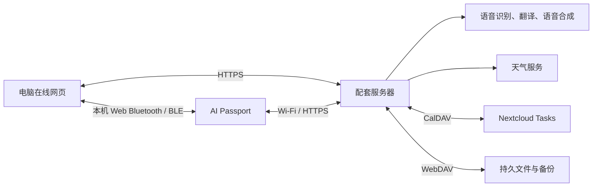

[English](passport-suite-plan.md) · **简体中文**

# AI Passport 多合一固件规划

更新于 2026-10-26，Asia/Shanghai。状态：首页、天气、设置和浏览器 BLE 配网已实现；待办已验收子集包含读取、完成、离线缓存/正常重启重放及 MiMo 语音新建。翻译 T1 已实现并部署，一次获准的合成真实供应商冒烟通过。2026-10-25 已从不可变原生归档仅应用恢复原始 OC-11 应用；用户确认恢复后的翻译菜单和原有数据正常，更早的原始镜像试验曾在就绪请求/麦克风之前以 `FAIL_CACHE_ALLOCATION`（`failure_result=6`）失败，内存原因未知。当前已安装应用为包 `d2975d36...`、应用 `79a0d3b5...`、ELF `9d71323f...`，3,697,184 字节，于 2026-10-26 以一次受护栏的仅应用写入落在 `[0x10000,0x397000)`；护栏 rc0 PASS，写入应用前全新 4,096 字节分区表扇区匹配 `ba728028...`，固定 esptool 摘要比对成功且标记为 1，COM3 已释放。一次 100.95 秒有界无复位启动窗口收到 0 个串行字节、0 个 TRDIAG 事件、0 个故障标记，无 boot ELF 行或 trace；数据缺失不等于稳定或启动 PASS。用户随后宣布就绪，两次受引导人工翻译（一次英译中、一次中译英）通过操作员报告的识别/翻译/显示检查且未见明显卡顿；操作员认为速度不是很快但可以接受，延迟原因未确定。设备测试仅对该单方向单次子集为 PASS。先前 `902a0930...` 安装属已被取代的按日期历史：其操作员报告的就绪 + 进入录音 + UP 取消一轮正常，其更晚真实 EN->zh-CN 在录音并按 OK 停止后以翻译缓存内存不足失败，无 A/F/L；失败 HTTP 调用与实机堆最大/空闲块未知。2026-10-26 完整门禁的 Build/Host PASS 沿用，未重跑固件。先前 `cb8bd517...` 的 TLS 预检失败与天气 `task_wdt` 仍属已被取代的按日期历史，关系未证明。精确当前证据见 [T1 核心当前检查点](passport-translation-t1-core.zh_CN.md#当前检查点2026-10-26)。T2/TTS 尚未实现，SA-15 仍不完整；OTP 和票夹仍为开发占位，下文其余建议不因写入规划即视为已实现。

目标是一份包含五项功能的多合一固件，配套在线管理网站。附近的浏览器通过蓝牙连接设备，设备使用自身 Wi-Fi 访问在线服务。用户已接受可选的手机浏览器配网，并完成 Android Edge 验证；原有电脑浏览器目标仍未验证。设置完成后的日常运行不依赖手机应用或手机热点。

用户决定范围和验收要求，由明确获准的编码代理实现、评审并验证各个增量。工程要求遵循 [AGENTS.md](../../AGENTS.md) 和 [AI 开发指南](../development/ai-guide.zh_CN.md)。

2026-10-20 确认：用户界面尽量使用简体中文，包含操作、按键提示、空白/加载状态
及错误信息（PRD SU-16）；保留用户原文及必要的标准标识。待办阅读器此次修正将
刷新入口固定在列表上方，进入时默认选中，缓存已有数据时同样可用。

## 0 当前实现与验收

更新于 2026-10-26。本节替代 2026-10-05 设计文档中笼统的实现状态描述；其中尚未满足的
要求和决策门槛继续生效。

当前缺口是响应性能定位及其他未验收场景，而非基础翻译缺失或需要再次刷写。已安装应用为包 `d2975d36...`、应用 `79a0d3b5...`、ELF `9d71323f...`，3,697,184 字节，于 2026-10-26 以一次受护栏的仅应用写入落在 `[0x10000,0x397000)`。护栏 rc0 PASS `APP_ONLY_WRITE_DIGEST_AND_CLOSE`，单次执行 78.57 秒，一次读加一次写桥接会话各自关闭，COM3 已确认释放；写入应用前，全新实机 4,096 字节分区表扇区匹配 `ba728028...`，固定 esptool 摘要比对成功且标记为 1。未写 bootloader/分区表/数据/密钥，设置、密钥、缓存、任务日志仅靠区间隔离保留。完整包是应用源码包身份，不是整片 Flash 克隆。一次 100.95 秒有界无复位启动窗口收到 0 个串行字节、0 个 TRDIAG 事件、0 个故障标记，无 boot ELF 行或 trace；这种缺失仅为按日期启动证据，不是干净、稳定或启动 PASS。随后在该安装上完成两次受引导人工试验（一次英译中、一次中译英）：操作员报告识别、翻译与显示均正确且未见明显卡顿，认为速度不是很快但可以接受，延迟原因未确定。设备测试仅对该单方向单次子集为 PASS。先前 `902a0930...` / 应用 `a71b9c3e...` / ELF `0352858d...` 安装属已被取代的按日期历史：其就绪/取消子集经操作员报告正常，其更晚真实 EN->zh-CN 在录音并按 OK 停止后以翻译缓存内存不足失败，无 A/F/L；具体失败 HTTP 调用与实机堆最大/空闲块未知。先前 `cb8bd517...` / 应用 `d0396c22...` / ELF `0ac23853...` 的 TLS 预检失败与一次天气 `task_wdt` 属已被取代的历史，关系未证明。2026-10-26 完整门禁的 Build/Host PASS 沿用，未重跑固件。精确屏幕、捕获与内存细节见 [T1 核心当前检查点](passport-translation-t1-core.zh_CN.md#当前检查点2026-10-26)。已被取代的 `43501...` 试验是历史人工 `R7 H0 B0` 的来源；原始 `f9a849be...` / `f5be0652...` 与 `8e86` 归档仍属历史/回滚。`d2975d36` 刷写使用其当前人工有条件授权与独立 Codex 复核；本文档既不授权也不推定任何进一步刷写。

| 范围 | 已实现行为 | 证据及剩余边界 |
| --- | --- | --- |
| 首页星轨 | 软化相互引力、有限半径弹性接触与扫掠碰撞检测、有界速度/工作量、边界反弹和短拖尾 | 默认及优化构建通过引力、碰撞、高速擦碰、恢复和确定性 100,000 帧测试；用户确认速度合适、碰后弹开且本体不穿透，中文和时钟清晰 |
| 导航 | 新首页、功能菜单、设置和长按返回 | 用户完成两轮菜单/返回观察，确认进入配网页是主动操作 |
| 浏览器配网 | 实屏二维码、NimBLE 连接、六位应用配对码、Wi-Fi 扫描/保存、城市保存 | Android Edge 实测正确配对、多网络扫描、连接/IP、城市一致和天气显示通过；一次错码在手机被拒绝，同一会话内改用正确码后恢复 |
| 时钟和天气 | 网络校时、所选城市天气及独立模型/状态处理 | 用户确认日期时间同步正确、温度和天气已显示；未提供各操作的准确耗时 |
| 安全和持久化 | 当前 BLE 应用配对码检查、NVS 设置及加密的待办/翻译配置分区 | 不代表 SC-02 所建议的认证加密会话、签名可信时间或 OTP 安全已验收；近期启动已观察到自动重连已保存 Wi-Fi，分段写入也保留了非应用数据分区，但其余设置、schema 与安全检查未全部确立 |
| 待办 | 列表/详情、手动下载快照、双槽缓存、显式完成、八条持久重放、独立写令牌及 MiMo 语音新建 | 见[设备待办](passport-device-tasks.zh_CN.md)。批准的部署、Wi-Fi/时间/天气启动、用户完成/缓存/正常重启重放、语音预览/默认取消/识别及新建请求重启保留均通过。2026-10-23 实测的取消/重进子集已按用户要求收口；真实并发编辑冲突、物理断电及真实资源峰值仍未验证 |
| 翻译 | 启动器翻译页、明确方向、MiMo 采集/上传/轮询 worker（含显式本地 MOCK）、加密配置、仅翻译用 USB 配置下发，以及独立部署的伴随服务 | 真实 T1 代码、聚焦主机测试和定向 ESP-IDF 构建通过；伴随服务使用 MiMo `mimo-v2.5-asr` 与 `mimo-v2.6-flash`，一次获准的合成真实供应商 EN->zh-CN 冒烟 7.445 秒通过，产生一次 ASR 和一次 MT claim。原始 OC-11 应用于 2026-10-25 仅应用恢复，用户确认恢复后的菜单和原有数据正常；更早原始镜像的就绪尝试在就绪请求/麦克风之前以 `FAIL_CACHE_ALLOCATION`（`failure_result=6`）失败。当前 `d2975d36` 录音后响应缓存应用于 2026-10-26 仅应用安装且护栏 rc0 PASS；其 100.95 秒有界无复位启动窗口收到 0 个串行字节、0 个 TRDIAG 事件、0 个故障标记，无 boot ELF 行或 trace，属按日期启动证据，不是稳定或启动 PASS。随后两次受引导人工试验（一次英译中、一次中译英）通过操作员报告的录音、识别、文本翻译与显示检查，且未见明显卡顿；操作员认为速度不是很快但可以接受，延迟原因未确定。设备测试仅对该单方向单次子集为 PASS，不包含重复性、无泄漏、TTS 或 SA-15 验收。先前 `902a0930` 安装属已被取代的按日期历史：其就绪/取消子集经操作员报告正常，其更晚真实 EN->zh-CN 在录音并按 OK 停止后以翻译缓存内存不足失败，无 A/F/L。失败 HTTP 调用与实机堆最大/空闲块未知。2026-10-26 完整门禁的 Build/Host PASS 沿用，未重跑固件。先前 `cb8bd517` 的 TLS 预检失败与天气 `task_wdt` 仍属已被取代的历史，关系未证明。精确屏幕、捕获与剩余缺口见 [T1 核心当前检查点](passport-translation-t1-core.zh_CN.md#当前检查点2026-10-26)。这不等于重复性、账单或 SA-15 验收 |
| OTP、票夹 | 功能菜单中的明确开发占位页 | 尚无实现或业务功能验收 |

### 产物身份，2026-10-25

| 角色 | 完整镜像 SHA-256 | 应用 SHA-256 | ELF SHA-256 |
| --- | --- | --- | --- |
| 获准的原生 OC-11 包；原始 f9/f5 应用已在此前恢复（2026-10-25 仅应用恢复），用户确认菜单/数据正常，现已被取代；归档保留作回滚 | `8e86d04143d5db795b966536007bdc81918cd63564c2d3b615a0d968f6835f1e` | `f9a849bee50860667d7323bc48d2da9a7c7f8629e79f100abf725a9a2329fd18` | `f5be0652e9fe9d9f70c91b5c9f2e2eb7fd9915b077bf1a84df3ad87ccf0d0170` |
| 2026-10-25 先前已安装 TLS 快照应用 — 已被取代的历史；一次 EN->zh-CN TLS 预检 FAIL 与一次天气 task_wdt，与 902a 关系未知 | `cb8bd51719e57e7f3ae1d87d6a7c55ed5145dd4d45c9349c86ee2ebacf0d9a03` | `d0396c225ff00fbe5f4319e4c757b44dd8d4071beed0c2dbfad24fa7be7170fc` | `0ac23853615f24ab2a294389e590e7a6665f8a804955a3089548536f8b194281` |
| 2026-10-26 当前已安装录音后响应缓存应用 — 受护栏仅应用写入 PASS；启动有界；操作员报告的单方向单次双向设备测试 PASS | `d2975d36eca1b89d98dd27f47711833f06afb4a8bb9a618eee11b0d357b94b0d` | `79a0d3b5a59f5d1084267642837566b66054cb5d3ff3e06003457197371f59c1` | `9d71323ff8a1eb3231171dd2e6834f0f19d2ed07fb52c8fd413d4a97091ab66f` |
| 2026-10-26 已被取代的已安装 TLS 内存生命周期应用 — 已由 d2975d36 取代；操作员就绪/取消子集 PASS，更晚真实 EN->zh-CN 录音后 FAIL（缓存 OOM） | `902a0930c258cc93920811b7291f19a60c26f9f4ba73715ddab776d846c65fff` | `a71b9c3eeaf4c4594cb646333ea11a71fe2b77efdee53e6de07fff95818158b6` | `0352858d245e8a5c181f4b1a17efe3ebdbc9baec3b356ebcd58fc78cc5a33bff` |
| 2026-10-25 已被取代的诊断应用 — 先前 R7 H0 B0 试验；已由 cb8bd517 取代 | `43501bd4e8640969abd402d178346001fad1dca308a4486bcd67755cb9d7e8ff` | `4b1fc8173c6d859c1ae01f15035b01677f43f2a5591061152a68424208ec4d19` | `8f65263c6a3f2b481b03579273aaef0c27bcbcdf1791e0a13809bd91c4be16e9` |
| 2026-10-24 仅验证原生归档，从未刷写 | `119f73c2ae8182b42c8a77de42a1a588707274885087901f13f20541a0497d03` | 本规划未记录 | `f4f4f1543d5e6b831ba7da69ee6a46c4d287fff8a883f03f6bde86c8d2c1a662` |
| 2026-10-25 仅文档门禁归档 — VALIDATION_ONLY_NOT_FLASHED | `c3b3795374405a97182e6ce447a1193caff286da8df7b9b82aafd98c0cd6dc63` | `f7584fd364169adc6b7d4117350e7d11d38780a6f4f5850d3725a8c3f8d1b98c` | `abce9bd8999825682267406f51253ece0b2871454a47adc2abcc27e62a5fc367` |
| 2026-10-25 误刷的旧 Windows 构建（按日期记录的事故；不再是当前安装） | `4b0187a075d403915d0fd7e09a6a4d72a104cd9a899a2a69af7bb2a74204495a` | `ecbbdc449374d99ad687350288b56c0c5df5b572b4ed255dbb2b1f05dbdb2e65` | `06e78957ac5a5d42dfd51f54e39972ca5ef1b602e51a2ba59506bb98e108e2db` |

当前 OC-11 仅应用区间为 `[0x10000,0x397000)`；当前应用 3,697,184 字节，分区表
SHA-256 为 `34899c032800849c9fc300bc27ff086499ffd90faf3b76d2ab6dc8092750c5bf`。
2026-10-26 已在该区间仅应用写入 `d2975d36` 应用；护栏 rc0 PASS
`APP_ONLY_WRITE_DIGEST_AND_CLOSE`，写入应用前全新实机 4,096 字节分区表扇区匹配
`ba72802878f6cf77acb0a37612e2fb7f9cf830133889bec9438cdd7f8c8fbdab`，固定 esptool
摘要比对成功且标记为 1，COM3 已释放。bootloader、分区表和全部数据分区均未改动，
因此设备整片 Flash 不等于合并归档 `d2975d36`；该归档是已安装应用的包身份，不是
整片 Flash 克隆。一次 100.95 秒有界无复位启动窗口收到 0 个串行字节、0 个 TRDIAG
事件、0 个故障标记，无 boot ELF 行或 trace；该缺失仅为按日期启动证据，不是稳定或启动 PASS。上述两次受引导双向人工试验随后在该安装上完成。先前 `902a0930` 安装及其 100.91 秒 /
112 字节窗口属已被取代的按日期历史：其就绪/取消子集经操作员报告正常，其更晚真实
EN->zh-CN 在录音并按 OK 停止后以翻译缓存内存不足失败，无 A/F/L；失败 HTTP 调用与
实机堆最大/空闲块未知。更早的 `cb8bd517` 应用及其 TLS 预检与天气 `task_wdt` 记录
同样属已被取代的按日期历史，关系未证明。`8e86d041` 恢复使用
`[0x10000,0x396000)`，仍属历史回滚。`119f73c2` 归档从未刷写。可变
`build/FoloToy-...-full.bin` 或后续重建也不代表已安装身份。内存生命周期改动在源码中
每次 HTTP 调用延后申请 8,193 字节，并在 ready 阶段再延后 4,098 字节；实机堆收益未
测量，容量上限与严格 TLS 行为不变。`d2975d36...` 的刷写前门禁阶段记录
（VALIDATED_NOT_FLASHED）仍属历史；上述实际安装取代其作为当前状态。

### 2026-10-25 事故（按日期记录；已由仅应用恢复取代）

Codex 误将旧 Windows 快照而非原生树用于构建和刷写。三个区段
`[0,0x6000)`、`[0x8000,0x9000)`、`[0x10000,0x385000)` 均校验通过，五个非应用数据分区
MD5 在写入前后及应用启动前完全一致。用户确认首页、按键、缓存和请求状态正常。其启动器
只有翻译占位页；这不表示原生翻译不存在。启动时出现真实的 IDLE CPU0 task watchdog
（15,352 ms），当时任务为 LVGL、PC 位于 RGB565 混合代码；设备继续运行并更新了天气。
未确定根因，且该 watchdog 属于旧 `4b0187` 构建，不是 OC-11 的证据。该构建随后已被
2026-10-25 对原始 OC-11 应用的仅应用恢复替换，因此 `4b0187` 属于历史而非当前安装。
本次文档变更不授权刷写，也不得据此推定同意。恢复遵循 `passport-device-test` 及原始
OC-11 镜像 2026-10-24 的明确同意。不要因本文档而重刷。

### 按日期记录的历史

- 2026-10-18/19：`8ca9ded-dirty` / `abd506e4` 验收基线验证了首页星轨、导航、Android
  Edge 配网、时钟/天气及首个 Nextcloud 读取增量。其完整镜像 SHA-256 `abd506e4...`
  和 ELF `da340763...` 属于被取代的历史，不是当前产物或当前缺口。
- 2026-10-19：伴随读取服务部署到 `/suite/v1/` 之后，真实读取返回 154 条带 ETag 的任务；
  当时设备界面、令牌配置和设备缓存仍待完成。
- 2026-10-20 至 2026-10-23：完成操作、离线缓存与正常重启重放、MiMo 语音新建，以及
  OC-01 到 OC-11 各增量。详情及证据边界见[设备待办](passport-device-tasks.zh_CN.md)、
  [Nextcloud](passport-nextcloud.zh_CN.md)、[翻译方案](passport-translation-plan.zh_CN.md)、
  [翻译 T1 核心](passport-translation-t1-core.zh_CN.md)及
  [可靠性复核](passport-reliability-review.zh_CN.md)。

## 1 最新功能范围

下方五项功能范围仍然有效。截至 2026-10-25，待办与翻译 T1 已实现，OTP 与票夹仍为
占位页，首版翻译仍为中文 ↔ 英文。2026-10-19 至 2026-10-23 的逐日进展已在第 0 节
汇总，并在所链接文档中连同证据边界保留；这些段落属于历史，不是当前下一步。不要
重启已收口的待办验收或防御性测试轮次。

| 原需求编号 | 调整后的功能 | 已确认安排 |
| --- | --- | --- |
| 1 | 随行语音翻译 | 保留；T1 已用 MiMo `mimo-v2.5-asr` + `mimo-v2.6-flash` 实现中文 ↔ 英文；T2/TTS 待完成 |
| 2 | OTP 验证码应用 | 保留并继续详细设计；取消原来必须最后才设计的限制 |
| 3、7 | 随行票夹，含铁路信息 | 合并为一个应用；展示车票、机票、演出票等票面信息，支持原始有效二维码；取消车站大屏和无车票出发列表 |
| 4 | Nextcloud 待办 | 必须完成真实待办列表连接、读取和设备显示；设备读取列表并可标记完成；用户于 2026-10-21 新增语音创建需求 |
| 8 | 三体时钟和天气 | 保留；完成后作为默认首页 |
| 5、6、9、10、11、12 | 额度显示、编程助手控制、随行导游、中国打卡、QQ 音乐、PPT 翻页器 | 全部取消，不再作为延后事项，也不设计占位入口 |

取消与导游、打卡相关的路线生成、景点讲解、省份包、全国地图、印章、足迹、成就和心愿单。它们的资源、数据模型、接口、阶段及验收不再属于当前产品。票夹不扩展为导游或打卡应用。FIDO2、Passkey、U2F、密码库和 SSH 签名仍不在范围内。

## 2 连接方式与分工

| 通道 | 设计用途 |
| --- | --- |
| 电脑网页 ↔ 设备 BLE | 首次配网、设备绑定、少量设置和状态；OTP 导入使用独立受保护会话，不能直接沿用普通设置写入权限 |
| 设备 Wi-Fi ↔ 服务器 | 票据下载与同步、Nextcloud 待办、天气、校时、翻译音频及结果；无需电脑常开 |
| 电脑网页 ↔ 服务器 | 票据导入审核、任务连接设置、翻译语言及服务设置、设备管理和备份状态 |

蓝牙由访问网页的电脑连接附近设备，远端网站服务器不能直接连接用户设备的蓝牙。网页必须通过 HTTPS 提供，在用户点击连接后申请设备权限；电脑必须有可用蓝牙和支持 Web Bluetooth 的浏览器。[Chrome 官方说明](https://developer.chrome.com/docs/capabilities/bluetooth)列出平台差异，Linux 可能需要启用实验设置。先实测实际电脑、操作系统、浏览器版本及重连行为，再确定支持矩阵；不能默认所有浏览器均可连接。

本设计选择浏览器 BLE GATT 会话，不将已有 BLUFI 示例直接视为可用网页客户端。自定义服务 UUID、消息分片、大小限制、应答、超时、取消和版本兼容规则需重新详细设计。配网仅在设备实体确认后限时开放；敏感配置要求认证和保密，不能依赖设备名称、UUID 或浏览器授权作为设备认证。错误密码、断连和取消不得破坏此前可用配置。设备验证服务器身份后完成绑定，凭据支持撤销；TLS 时间初始化不得通过关闭证书验证解决。

Wi-Fi 与 BLE 的共存方式遵循 [ESP-IDF 5.5.3 共存文档](https://docs.espressif.com/projects/esp-idf/en/v5.5.3/esp32c3/api-guides/coexist.html)。建议完成设置后关闭 BLE 或限时启用，大下载与语音不并发；这些是待实测策略，不是吞吐或内存保证。浏览器 BLE 不可用时需评审另一种电脑配网方式，不回退到手机依赖。

原有服务器 WebDAV 持久存储和备份要求继续保留，但缩减为票据、设置、待办缓存及独立加密 OTP 备份，不保存已取消功能的数据。Nextcloud 待办使用 CalDAV，不能用 WebDAV 文件备份替代任务协议。服务地址和凭据在运行时私下配置。

## 3 随行票夹（合并铁路信息）

网页支持手动录入和粘贴文本，后续评估截图或文件识别。所有疑似字段须审核后发布；OCR 不是首版已完成能力。设备提供按日期排列的票据列表、票面详情和独立票码页，已完整下载的票据断网可查看。

| 票据类型 | 必需显示的信息（来源提供时） |
| --- | --- |
| 火车票 | 乘车日期、车次、上车站、下车站、出发/到达时间、车厢、座位或无座、席别；用户上车站与列车始发站区分 |
| 机票/登机牌 | 日期、航班、出发/到达机场及航站楼、出发/到达时间、座位；登机口和登机时间只显示有来源的信息及其更新状态 |
| 演出票 | 演出名称、场馆、场次日期时间、区域、排、座位；站票明确标注 |
| 其他票据 | 名称、票种、有效期、场所或地址、入场说明、来源提供的座位，以及二维码或条形码 |

共同字段包括稳定票据 ID、版本、时区、票种、来源、审核状态、最后更新、缺失字段原因和票码可用状态。跨午夜和跨时区时间携带完整日期；不使用缺省值冒充真实座位、车站或登机口。

取消车站大屏、全站出发列表、实时检票状态与大屏数据源调查。原计划的途径站、停站时间和车型不作为新范围的必需验收项；如以后需要再单独确认。个人票面可靠信息不依赖实时铁路接口。

只展示发行方提供的原始票码内容或经验证的原图，不把订单号、座位或车次自行拼成通行码。铁路信息页不意味着可以替代身份证或官方乘车凭证。支持能有效缓存的静态二维码或条形码；动态、短时、身份绑定码须先核实发行方规则，不能承诺离线通行。没有有效码时显示原因，保留详情。

票码页保留静区、整数缩放和屏幕安全边界，停止无关动画；需要真机扫描及实际票务规则验证。浏览票据或展示票码不自动表示已核销。票据删除和缓存清理分开，同步错误不覆盖当前可用票据。

## 4 随行语音翻译

T1 已按获准设计实现：启动器翻译页、明确的 `en`/`zh-CN` 方向、用户主动触发且有界的
录音（0.3–10 秒、16 kHz/16 位/单声道）、最多 320,044 字节的单个规范 WAV（存于自有
非活动 Flash 槽）、一次有界认证上传，以及独立部署的伴随服务（MiMo
`mimo-v2.5-asr` 识别、`mimo-v2.6-flash` 翻译）。参见
[获准方案](passport-translation-plan.zh_CN.md)、
[存储与配置](passport-translation-device.zh_CN.md)、
[供应商与 HTTP 契约](passport-translation-provider.zh_CN.md)及
[T1 核心](passport-translation-t1-core.zh_CN.md)。

已验收证据：伴随服务部署、历史上真机翻译页可打开、一次获准的合成真实供应商
EN->zh-CN 冒烟、当前安装上两次受引导的单方向单次人工翻译（操作员报告识别、翻译与
显示正确且未见明显卡顿），以及先前 `902a...` 的操作员就绪/取消子集（按日期历史）。
操作员认为响应速度不是很快但可以接受；该性能观察未量化，原因未确定。未验收：重复性、
长期稳定性、TTS、供应商计费及 SA-15；恢复后的 OC-11 菜单/数据确认仍属操作历史，
且该先前安装上的完整真实翻译在录音并按 OK 停止后以翻译缓存内存不足失败，无 A/F/L。
失败 HTTP 调用与实机堆最大/空闲块仍未知。2026-10-26 完整门禁的 Build/Host PASS 沿用，
未重跑固件。先前 `cb8bd517` 的 TLS 预检失败与天气 `task_wdt` 属已被取代的历史，不是
关于当前安装的证据。精确屏幕数值、捕获状态、根因边界与任务看门狗见
[T1 核心当前检查点](passport-translation-t1-core.zh_CN.md#当前检查点2026-10-26)。

T2 以及新增语言、自动源语言检测、历史记录或本地离线模型仍为建议。DeepSeek 不是生产
翻译供应商；OpenCode Go DeepSeek V4.1 Flash 仅用于开发。

## 5 OTP 验证码

本轮开始详细设计，不再等待其他功能全部完成。建议先以 TOTP 为基础；算法、位数、周期及是否支持 HOTP 按实际账户兼容性确认。设备本地生成验证码，正常离线使用；时间不可信时提示校时，不能伪装成可用验证码。

导入流程建议在电脑网页本地解析标准 OTP URI 或二维码，展示发行者、账户、算法和参数，再通过受保护 BLE 会话写入设备，并要求实体确认。导入页面避免第三方脚本，不默认上传明文种子到服务器；详细设计仍须明确如何验证设备身份、保护传输和清理浏览器临时数据。

确定解锁方式、闲置锁定、种子存储、时间漂移、加密备份、恢复、删除和升级保存策略后才能引入真实种子。独立加密 OTP 备份可沿用 WebDAV 存储，但不得混入普通票据导出；恢复材料不能只保存在设备上，备份访问不能仅依赖这台设备生成的 OTP。先用公开测试向量和虚构账户验收，不在源码、日志、截图或测试样本写入真实种子。硬件安全配置及 eFuse 写入另行评审。

## 6 Nextcloud 待办

必须完成真实连接，而不是仅展示样本列表。服务器保存 Nextcloud 连接配置，通过 CalDAV 发现并读取支持任务的集合，将有上限的任务列表同步到设备。[Nextcloud Tasks 官方说明](https://github.com/nextcloud/tasks)列出 CalDAV 同步方式及 ETag 冲突处理要求。

必需行为包括选择列表、显示标题、完成状态、到期日和可用备注，显示最后同步时间、手动刷新、空列表、认证失败及缓存过期状态。离线保留已下载任务，并标记缓存；“服务器已连接”和“设备已下载”分开显示。正确处理全天日期、时区、无到期日及长文本。重复任务、子任务及共享列表兼容性需用实际 Nextcloud 版本验证。

设备标记完成为必需：用户选择任务并明确确认后保存操作，显示待同步、成功或失败；断网操作持久排队，重启后继续重试。必须定义任务 UID、ETag 条件更新、幂等重试和冲突界面，不能覆盖网页端较新的修改。恢复未完成待另行确认；根据 2026-10-21 范围决策，必须支持语音新建待办（SU-17）。

## 7 三体时钟和天气及交互

三体时钟完成后为默认开机首页，显示三体风格动态场景、日期、时间、指定城市天气和功能入口。使用有上限的程序绘制；时钟不可信和天气过期分别提示。天气失败不阻止显示本地时间或进入其他功能；城市可在电脑网页设置，字体、帧率、休眠和耗电待真机验证。

功能选择页只包含翻译、OTP、票夹、待办以及设置/同步。设置页承载配网、绑定、城市、语言和设备状态，不恢复已取消功能入口。应用重新设计 UI，不使用基线测试菜单或演示外壳。

设备使用上下和确认三个按键，不依赖同时按键。列表上下移动、确认打开；长按确认建议进入包含返回的操作菜单。翻译录音页使用明确独立手势；票码确认返回详情。详细 PRD 要逐页定义短按、长按、松开、取消和返回。按钮回调非阻塞，跨任务 LVGL 操作持锁；页面删除前停止所有能访问它的任务和回调。

## 8 资源、同步与数据保存

目标硬件仍为 ESP32-C3、8 MB Flash、无 PSRAM、ESP-IDF 5.5.3。删除省份包、讲解和地图预算，旧 D1 的 5 MiB 应用与双资源槽方案不再作为当前存储设计依据；先测应用、字体、票码缓存、音频缓冲和 BLE/Wi-Fi/TLS 峰值，再确定应用专用分区。上游默认分区表保持最小布局。

票据和缓存版本在完整校验后启用，失败保留旧版本；限制导入、网络响应、票码和音频大小，避免整文件入 RAM。服务器在可靠保存记录和上传队列后确认同步，将设备本地保存、服务器接收、WebDAV 备份完成分开显示。备份支持空白实例恢复，OTP 使用独立保密和恢复流程。实际保留数据的刷写方案需在实施阶段明确。

## 9 后续设计与验收

2026-10-05 的[五合一 PRD](passport-suite-prd.zh_CN.md)、[协议](passport-suite-contract.zh_CN.md)及[阶段提示词](passport-suite-prompts.zh_CN.md)已将此范围展开为页面、协议和重编任务。新增工作以 SU/SC/ST/SA 编号为准；下表只是工作块概览，不构成另一套任务顺序。翻译 T1 已实现；OTP 设计与后续阶段仍按各自门槛推进。

下表为建议工作顺序，不是工期承诺或编码授权。OTP 的设计与实现仍受其自身安全决策约束；翻译 T1 已实现，T2 另行推进。

| 工作块 | 设计交付 | 验收重点 |
| --- | --- | --- |
| 连接基础 | 电脑浏览器支持矩阵、BLE 安全会话、配网/绑定协议、Wi-Fi HTTPS、校时和资源预算 | 实际电脑配网；错误口令、权限拒绝、超时、断连、重连、共存及重启 |
| 五项功能详细设计 | 逐页 UI/按键、翻译服务与语言、OTP 安全方案、票据字段及 Nextcloud 读取/标记完成协议 | 五项范围完整，已取消入口和依赖不存在 |
| 票夹与待办 | 导入审核、票据同步、CalDAV 真连接、离线缓存 | 火车/飞机/演出票缺字段及跨日；票码扫描；真实任务读取、标记完成、离线重试及并发冲突 |
| 时钟与天气 | 默认首页、天气源、城市设置、时间状态 | 重启首页、天气过期、长时间运行及功耗 |
| 翻译 | 有界录音、识别/翻译/合成、取消及字形 | 实际语言服务、播放、失败、超时及断网 |
| OTP | 本地生成、受保护导入、解锁、加密备份与恢复 | 测试向量、错误时间、断网、错误恢复材料及无原设备恢复 |
| 整体验证 | 主机测试、完整仓库门禁和真机混合使用 | 内存、栈、任务退出、数据保留和连接切换 |

当前实现和证据见第 0 节；其余尚待决策的功能、安全和资源建议仍未验证。开发前检查五项必需技能可用；实际固件交付分开报告 Build、Host tests、Device tests 和 Unverified，并按仓库要求主动提供获准后的设备测试。

## 10 已删除的旧文档

2026-10-03 的旅行 PRD、旅行数据约定、OpenCode 提示词及 D0 设计评审属于已取消的
导游/打卡范围。它们已删除，并由本规划及五合一 PRD/协议/提示词取代。不得沿用
D1—D9 阶段、SoftAP/手机配网、导游打卡协议或验收号，也不得重建或重新链接这些文档。
可复用工程原则须先纳入当前五项功能设计。

## 语音新建待办范围，2026-10-21

用户新增 SU-17，选择 MiMo 按量 API，先实现并验证代码。此决定替代此前排除任务
创建的范围，当时并未选定翻译/TTS 服务；后续获准的翻译选择见
[翻译方案](passport-translation-plan.zh_CN.md)。见[SC-06.1](passport-suite-contract.zh_CN.md#sc-061-语音新建待办)
及[设备验收](passport-device-tasks.zh_CN.md#离线重启与重放验收2026-10-21)。
所需流程为录音、转写、核对识别原文标题，再通过默认取消的明确确认，创建到唯一
已选且可写的 Tasks 列表。不推断截止日期，不自动创建。

原 d5779c7e 固件已由用户验证：离线缓存/详情可读、刷新失败保留缓存、离线完成
请求持久保存、正常重启保留及恢复联网重放。网页版已完成，设备无冲突，刷新后
活动任务为零。真实并发编辑冲突、物理断电及内存余量仍待验证。语音固件 10f8cb21 和 MiMo 服务已部署。真实录音识别、中文预览/默认取消及新建
请求正常重启保留已通过。识别需在线服务；离线测试仅覆盖识别后断网。新资源的空
REPORT 曾导致写入前暂停；仅服务端的修复已通过完整门禁并部署。原已确认请求
经一次设备重试成功；独立只读核验确认一条匹配的 Nextcloud 资源和一份 SUCCEEDED
回执，无需重新录音或刷写。语音新建/重启/重试子集验收完成；前述运行时测量和
故障注入边界仍未验证。
